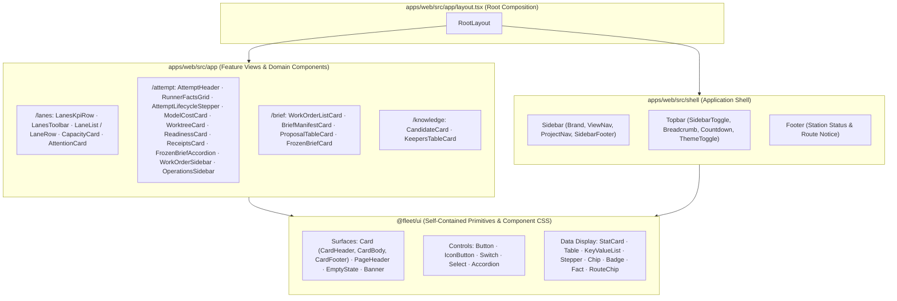

# UI & Design System Refactoring Plan

*Date: 2026-10-14 · Status: draft, not adopted · Owner decision: pending*

## 1. Code Review of Current Implementation (`apps/web`, `packages/ui`, `docs/DESIGN.md`)

### 1.1 `docs/DESIGN.md` vs. Reality
* **Stated Rule Violation — "Never Hard-Code a Colour":** `docs/DESIGN.md` states that components and views never hard-code colours so that both themes work seamlessly. In reality, only `apps/web/src/app/globals.css` and `@fleet/ui` follow this.
* **Outdated Visual Source-of-Truth Rule:** `docs/DESIGN.md` currently states that `docs/planning/2026-10-13_waves-dashboard.html` wins when it disagrees with `@fleet/ui`. This refactor retires that rule.
* **Broken Light Mode Twin Across All Views:**
  * `apps/web/src/app/lanes/lanes.module.css` hardcodes dark-mode hex and RGBA literals (`#04060b`, `#93a0bb`, `#e9eef7`, `#78849f`, `#22d3ee`, `rgba(148, 163, 184, 0.08)`). Switching to `[data-theme="light"]` turns the shell light while leaving lane cards and text dark-on-dark or low-contrast.
  * `apps/web/src/app/attempt/attempt-client.tsx` is a **1,276-line monolith** using 100% inline `style={{ ... }}` objects with hardcoded dark hex literals (`#05070d`, `#e9eef7`, `#93a0bb`, `#34d399`, `#fb7185`) and renders its own nested `<main style={{ minHeight: "100vh", background: "#05070d" }}>` inside the root layout's `<main className="page">`.
  * `apps/web/src/app/brief/page.tsx` injects an inline `<style>` tag scoped to `.fc` that forces `color-scheme: dark` and re-declares dark-only `--bg`, `--card`, and `--text` variables, completely ignoring the root theme toggle.
  * `apps/web/src/app/knowledge/knowledge.module.css` re-declares `--bg: #05070d`, `--card: #0a0e18`, etc. on `.page`, overriding `:root[data-theme="light"]` and forcing a dark radial background inside the page container.

### 1.2 Architectural & Component Decomposition Issues
* **Missing Component Decomposition:**
  * `packages/ui` only exports 5 micro-primitives (`Badge`, `Card`, `Fact`, `IconButton`, `RouteChip`).
  * Complex patterns—switches, buttons, tables, KPI stat blocks, key-value description lists, callout banners/notes, horizontal steppers, and page headers—are copy-pasted across all four route directories with inconsistent markup and styling techniques (CSS Modules vs. inline `style` objects vs. inline `<style>` tags).
  * Even existing `@fleet/ui` components are bypassed in several places:
    * `apps/web/src/app/lanes/page.tsx` and `apps/web/src/app/knowledge/page.tsx` manually re-implement `RouteChip` using `.route.routeGap` classes.
    * `apps/web/src/app/brief/page.tsx` manually renders `` instead of `Badge`.
    * `apps/web/src/shell/theme-toggle.tsx` uses `<button className="iconbtn">` instead of `IconButton`.
* **Stale Comments & Coupled Shell / Fixture State:**
  * `apps/web/src/app/layout.tsx` contains a stale comment claiming `@fleet/ui` does not resolve in the worktree, even though `lanes`, `attempt`, `brief`, and `knowledge` all import from `@fleet/ui`.
  * `apps/web/src/shell/project-nav.tsx` imports `attempts` and `workOrders` directly from `../app/lanes/fixture` and hardcodes `router.push('/lanes?project=...')` even when the operator is viewing `/knowledge`, `/attempt`, or `/brief`.
  * Duplicate fixture definitions exist across `apps/web/src/app/lanes/fixture.ts`, `apps/web/src/app/attempt/fixture.ts`, and `apps/web/src/app/brief/fixture.ts`.

---

## 2. Target Admin Design System Specification

The refactored Fleet v2 operator UI adopts a self-contained, zero-CDN admin design system built around CSS custom properties, a fixed dark-slate navigation sidebar, a sticky translucent topbar, and pure React primitives in `@fleet/ui`.

1. **Core Visual DNA & Tokens:**
   * **First Paint & Staged Theme Rollout:** `:root` defines the **Light mode** token palette (`--body-bg: #f5f7fb`, `--bg-surface: #ffffff`, `--bg-surface-secondary: #f9fafb`) and `[data-theme="dark"]` defines the **Dark mode** token palette (`--body-bg: #0f1623`, `--bg-surface: #1a2332`, `--bg-surface-secondary: #141d2b`). Because `lanes`, `attempt`, `brief`, and `knowledge` contain hardcoded dark hex literals until Phases 5–7, `apps/web/src/app/layout.tsx` **keeps the pre-paint result `dark` through Phases 1–6** so operators with a light OS preference never hit the broken light twin on unmigrated routes. In **Phase 7**, once every view has migrated off hardcoded colours, `apps/web/src/app/layout.tsx` removes `data-theme="dark"` from `<html>` and switches the pre-paint inline `<script>` to resolve `localStorage.getItem('theme')` → `window.matchMedia('(prefers-color-scheme: dark)').matches ? 'dark' : 'light'` → `'light'`.
   * **Sidebar Surface:** Dedicated dark slate rail (`--sidebar-bg: #1a2332`, `--sidebar-w: 252px`, `--sidebar-active: rgba(26,187,156,0.08)`, `--sidebar-text: #7b8fa3`, `--sidebar-text-active: #ffffff`), collapsible to a `64px` icon rail on desktop (`body.sidebar-rail`) or off-canvas drawer on mobile.
   * **Primary Accent:** Teal `#1ABB9C` (`--primary`, `--primary-lt`, `--primary-dk: #169f85`).
   * **Semantic Palette & Tints:** `--green: #2fb344`, `--yellow: #f59f00`, `--red: #d63939`, `--blue: #066fd1`, `--azure: #4299e1`, `--purple: #ae3ec9`, `--cyan: #17a2b8`, `--orange: #f76707`, each paired with a `-lt` translucent wash (`6%` in light mode, `14%–18%` in dark mode).
   * **Borders & Shadows:** Hairline borders (`--border-color: #e6e7eb` in light / `rgba(255,255,255,0.08)` in dark, `--border-color-light`, `--border-translucent`) and subtle elevation (`--shadow: rgba(30,38,51,0.04) 0 2px 4px 0`, `--shadow-card`).
   * **Offline System Typography & Spacing:** Zero external network or CDN font fetches, and `Inter` is dropped from the stack so rendering never depends on what is installed on an operator's machine. Uses the pure system UI font stack (`--font-sans: -apple-system, BlinkMacSystemFont, "Segoe UI", Roboto, Helvetica, Arial, sans-serif`; `0.875rem` / `14px`, line-height `1.4286`, weights `400/500/600`), `--font-mono` (`ui-monospace, "SF Mono", Menlo, Monaco, Consolas, monospace`), radii (`--radius-sm: 4px`, `--radius: 6px`, `--radius-lg: 8px`), and a 4px spacing scale (`--space-1: 4px` through `--space-8: 64px`).
2. **CSS Ownership Boundary (`globals.css` vs. `packages/ui`):**
   * **`apps/web/src/app/globals.css`** holds **only** CSS custom property token definitions (`:root` and `[data-theme="dark"]`), base document resets, shell layout classes (`.sidebar`, `.topbar`, `.main`, `.page-wrapper`, `.footer`), and `apps/web`-only page grid classes (`.row`, `.col-4`, `.col-3`, `.col-2`, `.col-8-4`, `.col-4-8`, `.col-1`). Grid classes in `globals.css` are restricted strictly to shell and page layout in `apps/web`; no `packages/ui` primitive may depend on `.row` or `.col-*`.
   * **`packages/ui`** owns all component CSS (cards, buttons, tables, forms, switches, selects, badges, chips, facts, stat cards, steppers, banners, key-value lists, accordions, page headers, and empty states) so every `@fleet/ui` primitive renders independently of the Next.js app.

---

## 3. Architectural Decisions, Token Mapping & Semantics

### 3.1 Core Decisions Recorded in This Plan
1. **Visual Source of Truth & Attribution:** `docs/planning/2026-10-13_waves-dashboard.html` is retired as the visual source of truth. Rewritten `docs/DESIGN.md` and `@fleet/ui` become the sole authoritative visual specification. Where token values or component CSS rules are adapted from MIT-licensed admin styles, MIT licence notice/compliance is preserved without referencing external template brand names anywhere in project documentation, code comments, commits, or pull requests.
2. **First Paint & Staged Pre-Paint Script:** `:root` defines the Light theme by default and `[data-theme="dark"]` defines the Dark theme. However, because the four feature views still hardcode dark hex values until Phases 5–7, `apps/web/src/app/layout.tsx` keeps its pre-paint result `dark` (unless explicitly toggled via `localStorage('theme')`) during Phases 1–6. In **Phase 7**, once all four views can survive Light mode, `apps/web/src/app/layout.tsx` removes `data-theme="dark"` on `<html>` and updates the synchronous pre-paint inline `<script>` to:
   * `const stored = localStorage.getItem('theme');`
   * `const sysDark = window.matchMedia && window.matchMedia('(prefers-color-scheme: dark)').matches;`
   * `const theme = stored === 'dark' || stored === 'light' ? stored : (sysDark ? 'dark' : 'light');`
   * `document.documentElement.dataset.theme = theme;`
   Legacy variable aliases (`--bg`, `--card`, `--line`, etc.) do not determine first paint; they only bridge unmigrated views to the active theme during phased rollout.
3. **Pure System Fonts (No CDN, No Machine-Dependent Named Fonts):** Nothing is fetched from the network at runtime, and `Inter` is dropped from the font stack. `--font-sans` and `--font-mono` use deterministic system font stacks only.
4. **Strict Component & Grid CSS Ownership:** `apps/web/src/app/globals.css` contains only CSS custom properties, base resets, shell layout, and `apps/web`-only page grid classes (`.row`, `.col-*`). No `@fleet/ui` primitive may reference `.row` or `.col-*`. All primitive component styles live inside `packages/ui/src/` and are added alongside each component in Phase 2.
5. **Domain-Free Semantic Tones in `@fleet/ui`:** `@fleet/ui` primitives never import domain packages or use domain words (`door`, `blocked`, `keeper`) or raw colour names (`teal`, `purple`, `green`) in their tone APIs. `StatCard`, `Stepper`, `Banner`, `Button`, and `Chip` expose strictly semantic tones:
   * `neutral` | `accent` | `ok` | `warn` | `danger` | `decision`
   Feature views in `apps/web` map Fleet domain concepts onto these semantic tones.

### 3.2 Token & Semantic Tone Mapping

| Semantic Tone (`@fleet/ui`) | Fleet View Meaning (Assigned in `apps/web`) | CSS Token Pair | Light Mode Value | Dark Mode Value |
|---|---|---|---|---|
| Surface: Page | App background (`--body-bg`) | `--body-bg` | `#f5f7fb` | `#0f1623` |
| Surface: Card | Card & panel surface (`--bg-surface`) | `--bg-surface` | `#ffffff` | `#1a2332` |
| Surface: Secondary | Sunken / table header surface (`--bg-surface-secondary`) | `--bg-surface-secondary` | `#f9fafb` | `#141d2b` |
| Surface: Sidebar | Fixed navigation rail (`--sidebar-bg`) | `--sidebar-bg` | `#1a2332` | `#1a2332` |
| `accent` | Active attempt, primary action, `first` kind, current lifecycle step | `--primary` / `--primary-lt` | `#1ABB9C` / `rgba(26,187,156,0.06)` | `#1ABB9C` / `rgba(26,187,156,0.14)` |
| `ok` | `accepted`, `keeper`, `merge`, Fact `yes`, completed step | `--green` / `--green-lt` | `#2fb344` / `rgba(47,179,68,0.06)` | `#2fb344` / `rgba(47,179,68,0.16)` |
| `warn` | `unknown`, `candidate`, `route gap`, Fact `unknown` | `--yellow` / `--yellow-lt` | `#f59f00` / `rgba(245,159,0,0.06)` | `#f59f00` / `rgba(245,159,0,0.16)` |
| `danger` | `failed`, `stop`, failed verification/readiness | `--red` / `--red-lt` | `#d63939` / `rgba(214,57,57,0.06)` | `#d63939` / `rgba(214,57,57,0.16)` |
| `decision` | `blocked`, `fix`, `l3`, one-way door step, policy proposal | `--purple` / `--purple-lt` | `#ae3ec9` / `rgba(174,62,201,0.06)` | `#ae3ec9` / `rgba(174,62,201,0.16)` |
| `neutral` | `ended`, `queued`, Fact `no`, Fact `stale`, pending step | `--text-muted` / `--border-color` | `#7e8896` / `#e6e7eb` | `#8a93a3` / `rgba(255,255,255,0.08)` |

---

## 4. Component Decomposition Map (`packages/ui` & `apps/web`)

Every UI piece is decomposed into single-responsibility components with zero hardcoded hex colours. Feature views depend **only** on `@fleet/ui`; `apps/web/src/app/layout.tsx` composes the shell around the active route.

### 4.1 `@fleet/ui` — Self-Contained Primitives (`packages/ui/src/`)
All components in `@fleet/ui` are pure React components with their own component styles inside `packages/ui`, zero domain imports, zero dependency on `apps/web` grid classes (`.row`, `.col-*`), zero console logging, and semantic tone props (`neutral | accent | ok | warn | danger | decision`):

#### Step 2A: Surfaces
1. **`Card.tsx`**
   * Because `Card` is already imported by `lanes/page.tsx` and `knowledge/page.tsx`, `Card` **keeps its current inline-token rendering in Phase 2A** while `CardHeader`, `CardBody`, and `CardFooter` are added beside it. `Card`'s own styles move onto `packages/ui` surface CSS when the views adopt the new `Card` composition (starting in Phase 5, with the legacy inline fallback removed in Phase 7).
   * `CardHeader`: `min-height: 44px`, `padding: 12px 16px`, border-bottom, with `title`, `subtitle`, and `actions` (`ReactNode`) slots.
   * `CardBody`: `padding: 16px`, optional `flush` for edge-to-edge tables/lists.
   * `CardFooter`: `padding: 10px 16px`, border-top.
2. **`PageHeader.tsx`**
   * Props: `pretitle`, `title`, `description`, `actions` (right-aligned slot for `RouteChip` or action buttons).
3. **`EmptyState.tsx`**
   * Standardized empty/filtered state container with optional icon, `title`, and `description`.
4. **`Banner.tsx`**
   * Callout container with semantic `tone` (`neutral` | `accent` | `ok` | `warn` | `danger` | `decision`), optional `title`, `meta`, and `actions`.

#### Step 2B: Controls
5. **`Button.tsx`**
   * Semantic `tone` (`accent` | `neutral` | `ok` | `warn` | `danger` | `decision`), `variant` (`solid` | `outline` | `ghost`), and `size` (`sm` `28px` | `md` `32px` | `lg` `38px`).
6. **`IconButton.tsx`**
   * Preserves existing `IconButtonProps` (`label`, `title`, button attributes) and moves onto `packages/ui` CSS in Phase 2B. This is safe in Phase 2B because no view or shell file in `apps/web` imports `IconButton` yet (`theme-toggle.tsx` uses a raw `<button>` until Phase 4).
7. **`Switch.tsx`**
   * `36×20px` pill track (`--primary` when checked, white thumb with shadow) + accessible label.
8. **`Select.tsx`**
   * Styled native `<select>` control (`32px` height, custom chevron, focus ring) with optional label.
9. **`Accordion.tsx`**
   * Styled `
` + `
` disclosure primitive with animated chevron and header slot.

#### Step 2C: Data Display
10. **`StatCard.tsx`**
    * Props: `label`, `value`, `subtext`, `icon`, `tone` (`neutral` | `accent` | `ok` | `warn` | `danger` | `decision`), optional `progress` (`0..100`).
11. **`Table.tsx`**
    * Composable `TableContainer`, `Table`, `Thead`, `Tbody`, `Tr`, `Th`, `Td` with `mono` and `strong` cell modifiers and optional `stickyHeader`.
12. **`KeyValueList.tsx`**
    * Structured `<dl>` with `KeyValueRow` (`term`, `mono`, `children`) for dense metadata inspection.
13. **`Stepper.tsx`**
    * Horizontal lifecycle step indicator. Each step takes `label`, `detail`, `state` (`done` | `active` | `pending`), and optional semantic `tone` (`neutral` | `accent` | `ok` | `warn` | `danger` | `decision`).
14. **`Chip.tsx`**
    * Compact `22px` metadata pill with semantic `tone` (`neutral` | `accent` | `ok` | `warn` | `danger` | `decision`).
15. **`Badge.tsx`**, **`Fact.tsx`**, and **`RouteChip.tsx`**
    * Preserve exact union types (`BadgeKind`, `BadgeVariant`, `FactState`, `RouteChipVariant`) enforced by `packages/ui/src/type-tests.tsx`.
    * Keep their current inline-token rendering during Phase 2 so unmigrated views are untouched; migrate their internal styles to `packages/ui` CSS when their consuming views migrate (`Fact` in Phase 6A; `Badge` and `RouteChip` in Phase 7).

---

## 5. Atomically Phased Development Plan

### Verification Strategy Across All Phases
* **Compile Gate (`yarn build && yarn typecheck && yarn lint && yarn lint:arch && yarn sync:check`):** Verifies TypeScript types, architectural boundaries, and package builds, but **does not** by itself verify visual fidelity.
* **Per-Phase Browser Verification Pass:** Every visual phase requires an interactive browser inspection of the shell or route it touches in **both Light and Dark themes** (using the theme toggle while unmigrated views remain dark-first until Phase 7), verifying surface contrast, border legibility, interactive controls, and responsive behavior.
* **Full Workspace Gate:** Reserved for the final phase (`yarn build && yarn typecheck && yarn lint && yarn lint:arch && yarn test && yarn sync:check`) alongside switching first-paint resolution to system-preference + light fallback and running a complete end-to-end browser walkthrough of all four routes.

---

### Phase 1: Design System Documentation & Token Foundation (`docs/DESIGN.md` & `globals.css`)
* **Goal:** Rewrite `docs/DESIGN.md` to retire `2026-10-13_waves-dashboard.html` as the visual source of truth, and establish the new token system and shell/page-grid layout in `apps/web/src/app/globals.css` while keeping the pre-paint result `dark` until views migrate in Phases 5–7.
* **Files to Modify:**
  * `docs/DESIGN.md`
  * `apps/web/src/app/globals.css`
* **Key Actions:**
  1. **Rewrite `docs/DESIGN.md`:**
     * Retire `docs/planning/2026-10-13_waves-dashboard.html` as the visual source of truth; declare `docs/DESIGN.md` and `@fleet/ui` as authoritative.
     * Include MIT licence attribution notice for adapted token values and component CSS rules, without referencing external template names in documentation, commits, or PRs.
     * Document the pure system font stack (no `Inter`, no CDN font requests), light-default `:root` + `[data-theme="dark"]` token palette, semantic tone mapping (`neutral`, `accent`, `ok`, `warn`, `danger`, `decision`), and CSS ownership boundary (`globals.css` = tokens + shell layout + `apps/web`-only `.row`/`.col-*` page grid; `packages/ui` = self-contained component CSS with zero dependency on `.row`/`.col-*`).
  2. **Update `apps/web/src/app/globals.css`:**
     * Define `:root` (Light mode token palette) and `:root[data-theme="dark"]` (Dark mode token palette): `--body-bg`, `--bg-surface`, `--bg-surface-secondary`, `--sidebar-*`, `--primary*`, `--green*`, `--yellow*`, `--red*`, `--blue*`, `--azure*`, `--purple*`, `--cyan*`, `--border-*`, `--text*`, `--space-1..8`, `--radius*`, `--shadow*`, `--font-sans` (`-apple-system, BlinkMacSystemFont, "Segoe UI", Roboto, Helvetica, Arial, sans-serif`), `--font-mono` (`ui-monospace, "SF Mono", Menlo, Monaco, Consolas, monospace`).
     * Keep temporary legacy token aliases (`--bg`, `--card`, `--bg-sink`, `--line`, `--cyan`, `--emerald`, `--amber`, `--rose`, `--violet`, `--slate`) mapped to the active theme's tokens so existing views do not break before their migration phases.
     * Include **only** document resets, shell layout classes (`.sidebar`, `.topbar`, `.main`, `.page-wrapper`, `.footer`), and `apps/web`-only page grid layout classes (`.row`, `.col-*`). Do **not** add card, button, table, badge, or form classes to `globals.css`.
  3. **Keep Pre-Paint Result Dark Until Phase 7:**
     * Leave `data-theme="dark"` on `<html lang="en">` in `apps/web/src/app/layout.tsx` during Phases 1–6 so operators with a light OS preference do not land on unmigrated dark-hex views in Light mode. Light mode on individual views remains unverified until each view's migration phase (Phases 5–7).
* **Verification:**
  * Compile check: `yarn --cwd apps/web typecheck && yarn lint`.
  * Browser pass: Load `/lanes`, verify dark first paint remains intact with the new dark token palette and legacy aliases, and confirm zero font network requests fire.

---

### Phase 2: `@fleet/ui` Self-Contained Component Library (`packages/ui`)

Component CSS lives in `packages/ui/src/` and is added only when its corresponding React component is introduced. No `packages/ui` component may reference `.row` or `.col-*`. Existing `Card`, `Badge`, `Fact`, and `RouteChip` keep their current inline-token rendering in this phase so existing views remain visually intact until migrated.

#### Phase 2A: Surface Primitives (`Card`, `PageHeader`, `EmptyState`, `Banner`)
* **Files to Create/Modify:**
  * Modify: `packages/ui/src/Card.tsx` (keep `Card`'s current inline rendering for existing consumers while adding `CardHeader`, `CardBody`, and `CardFooter` beside it; move `Card`'s surface styles when the views adopt the new `Card` composition in Phases 5–7).
  * Create: `packages/ui/src/PageHeader.tsx`, `packages/ui/src/EmptyState.tsx`, `packages/ui/src/Banner.tsx`, and their component CSS inside `packages/ui/src/`.
  * Modify: `packages/ui/src/index.ts`, `packages/ui/src/type-tests.tsx`.
* **Verification:** `yarn --cwd packages/ui build && yarn --cwd packages/ui typecheck && yarn lint`.

#### Phase 2B: Control Primitives (`Button`, `IconButton`, `Switch`, `Select`, `Accordion`)
* **Files to Create/Modify:**
  * Modify: `packages/ui/src/IconButton.tsx` (preserve existing props while moving styles to `packages/ui` CSS; safe in 2B because no view or shell file in `apps/web` imports `IconButton` until Phase 4).
  * Create: `packages/ui/src/Button.tsx`, `packages/ui/src/Switch.tsx`, `packages/ui/src/Select.tsx`, `packages/ui/src/Accordion.tsx`, and their component CSS inside `packages/ui/src/`.
  * Modify: `packages/ui/src/index.ts`, `packages/ui/src/type-tests.tsx`.
* **Verification:** `yarn --cwd packages/ui build && yarn --cwd packages/ui typecheck && yarn lint`.

#### Phase 2C: Data Display Primitives (`StatCard`, `Table`, `KeyValueList`, `Stepper`, `Chip`)
* **Files to Create/Modify:**
  * Create: `packages/ui/src/StatCard.tsx`, `packages/ui/src/Table.tsx`, `packages/ui/src/KeyValueList.tsx`, `packages/ui/src/Stepper.tsx`, `packages/ui/src/Chip.tsx`, and their component CSS inside `packages/ui/src/`.
  * Ensure all tone props use `SemanticTone = 'neutral' | 'accent' | 'ok' | 'warn' | 'danger' | 'decision'` (no `door` or `teal` tone names).
  * Modify: `packages/ui/src/index.ts`, `packages/ui/src/type-tests.tsx`.
* **Verification:** `yarn --cwd packages/ui build && yarn --cwd packages/ui typecheck && yarn --cwd packages/ui test && yarn lint`.

---

### Phase 3: Shared Fixture Consolidation & Shell Navigation Decoupling
* **Goal:** Fix the two structural bugs identified in the code review before restyling the shell and views: consolidate duplicated fixture data into one shared module and decouple `apps/web/src/shell/project-nav.tsx` from `../app/lanes/fixture` while preserving the active pathname on project filter change.
* **Files to Create/Modify:**
  * Create: `apps/web/src/fixtures/station-fixture.ts` (single source of truth for station projects, work orders, attempts, capacity, briefs, and knowledge candidates/keepers).
  * Modify: `apps/web/src/app/lanes/fixture.ts`, `apps/web/src/app/attempt/fixture.ts`, and `apps/web/src/app/brief/fixture.ts` (re-export or replace with imports from `apps/web/src/fixtures/station-fixture.ts`, then remove redundant duplicate files once all imports point to `apps/web/src/fixtures/station-fixture.ts`).
  * Modify: `apps/web/src/shell/project-nav.tsx` to import fixture counts from `../fixtures/station-fixture` and use `usePathname()` + `useSearchParams()` so selecting a project navigates to `${pathname}?${params}` instead of hardcoding `/lanes`.
* **Verification:**
  * Compile check: `yarn --cwd apps/web typecheck && yarn lint && yarn lint:arch`.
  * Browser pass: Switch project filters while on `/lanes`, `/attempt`, `/brief`, and `/knowledge` and verify the URL stays on the current route while updating `?project=...`.

---

### Phase 4: Admin Shell Refactoring (`apps/web/src/shell/` & `layout.tsx`)
* **Goal:** Refactor the application shell into the fixed dark-slate `.sidebar` (`#1a2332`, `252px` wide, collapsible to `64px` icon rail on desktop and slide-over drawer on mobile), sticky `56px` `.topbar` (with sidebar toggle, route breadcrumb, 15s read cadence pill, and `IconButton` theme toggle), and `.footer`, while keeping the default pre-paint theme `dark` until Phase 7.
* **Files to Create/Modify:**
  * Create: `apps/web/src/shell/sidebar.tsx`, `apps/web/src/shell/topbar.tsx`, `apps/web/src/shell/footer.tsx`
  * Modify: `apps/web/src/shell/view-nav.tsx`, `apps/web/src/shell/project-nav.tsx`, `apps/web/src/shell/countdown.tsx`, `apps/web/src/shell/theme-toggle.tsx`, `apps/web/src/app/layout.tsx`
* **Verification:**
  * Compile check: `yarn --cwd apps/web typecheck && yarn lint`.
  * Browser pass (Shell in Light & Dark themes):
    * Verify desktop sidebar toggle collapses `252px` sidebar to `64px` icon rail (`body.sidebar-rail`) and expands cleanly.
    * Verify mobile viewport (`< 992px`) opens/closes the sidebar drawer with backdrop overlay.
    * Verify topbar breadcrumb updates across `/lanes`, `/attempt`, `/brief`, and `/knowledge`, countdown ticks every second, and theme toggle switches the shell (`sidebar`, `topbar`, `footer`, `--body-bg`) cleanly between Light and Dark.

---

### Phase 5: Lanes View Decomposition & Restyling (`apps/web/src/app/lanes/`)
* **Goal:** Decompose `apps/web/src/app/lanes/page.tsx` into focused components built on `@fleet/ui` (`PageHeader`, `StatCard`, `Card` with `CardHeader`/`CardBody`/`CardFooter`, `Switch`, `Select`, `Banner`, `Badge`, `RouteChip`, `EmptyState`), transition `Card` onto `packages/ui` surface CSS while keeping `Card`'s `padded`/`title` props backward-compatible for `knowledge/page.tsx`, and remove all hardcoded dark hex colours from `apps/web/src/app/lanes/lanes.module.css`.
* **Files to Create/Modify:**
  * Modify: `packages/ui/src/Card.tsx`
  * Create: `apps/web/src/app/lanes/components/lanes-kpi-row.tsx`, `lanes-toolbar.tsx`, `lane-row.tsx`, `live-clock.tsx`, `capacity-card.tsx`, `attention-card.tsx`
  * Modify: `apps/web/src/app/lanes/page.tsx`, `apps/web/src/app/lanes/lanes.module.css`
* **Verification:**
  * Compile check: `yarn build && yarn typecheck && yarn lint`.
  * Browser pass (Light & Dark themes on `/lanes`):
    * Verify contrast and card surfaces on `/lanes` in both Light and Dark mode.
    * Test the "show ended" `Switch`, state `Select` filter, project filter interaction, expandable lane observation details, capacity slot grid, and live ticking duration clock.

---

### Phase 6: Attempt View Decomposition & Restyling (`apps/web/src/app/attempt/`)

Split into two steps to safely dismantle the 1,276-line `apps/web/src/app/attempt/attempt-client.tsx` monolith and remove its nested `<main>` and inline hex styles:

#### Phase 6A: Attempt Main Record Column & `Fact` Restyle
* **Goal:** Extract the central Attempt Record column into dedicated components using `@fleet/ui` (`PageHeader`, `Card`, `Fact`, `Stepper`, `KeyValueList`, `Accordion`, `Banner`, `Badge`, `RouteChip`) and restyle `packages/ui/src/Fact.tsx` inside `packages/ui` (since `/attempt` is the sole consumer of `Fact`).
* **Files to Create/Modify:**
  * Modify: `packages/ui/src/Fact.tsx`
  * Create: `apps/web/src/app/attempt/components/attempt-header.tsx`, `runner-facts-grid.tsx`, `attempt-lifecycle-stepper.tsx`, `model-cost-card.tsx`, `worktree-card.tsx`, `readiness-card.tsx`, `receipts-card.tsx`, `frozen-brief-accordion.tsx`, `apps/web/src/app/attempt/attempt.module.css`
  * Modify: `apps/web/src/app/attempt/attempt-client.tsx`
* **Verification:**
  * Compile check: `yarn build && yarn typecheck && yarn lint`.
  * Browser pass (Light & Dark themes on `/attempt` main column): Inspect `/attempt` main record column—verify copy-attempt-ID button, 5 runner `Fact` cards (including stale warning banner), lifecycle `Stepper` tones (`done`, `active`, `decision`, `danger`, `warn`, `neutral`), worktree path accordions, 10 readiness checks, receipts list, and frozen brief markdown disclosure.

#### Phase 6B: Attempt Sidebars (`WorkOrderSidebar` & `OperationsSidebar`)
* **Goal:** Extract the left Work Order & sibling attempts column and the right Operations & Waves decision column, eliminating the remaining inline styles from `apps/web/src/app/attempt/attempt-client.tsx`.
* **Files to Create/Modify:**
  * Create: `apps/web/src/app/attempt/components/work-order-sidebar.tsx`, `operations-sidebar.tsx`
  * Modify: `apps/web/src/app/attempt/attempt-client.tsx`, `apps/web/src/app/attempt/attempt.module.css`
* **Verification:**
  * Compile check: `yarn --cwd apps/web typecheck && yarn lint`.
  * Browser pass (Light & Dark themes on `/attempt`): Verify full 3-column desktop layout and single-column responsive collapse on `/attempt` in both Light and Dark mode, sibling attempt switching, legal operations buttons, "Not offered, and why" explanations, and open Waves decision banner.

---

### Phase 7: Brief & Knowledge Views Decomposition, Final Primitive Restyle, Light-Default First Paint & Full Workspace Gate
* **Goal:** Decompose `apps/web/src/app/brief/page.tsx` and `apps/web/src/app/knowledge/page.tsx`, remove the `.fc` dark-mode lock in `brief/page.tsx` and the dark-theme variable overrides in `apps/web/src/app/knowledge/knowledge.module.css`, complete the `packages/ui` CSS migration for `packages/ui/src/Badge.tsx`, `packages/ui/src/RouteChip.tsx`, and `packages/ui/src/Card.tsx`, remove obsolete legacy CSS aliases from `globals.css`, and switch `apps/web/src/app/layout.tsx` pre-paint resolution to system-preference with Light fallback now that all four views support Light mode cleanly.
* **Files to Create/Modify:**
  * Modify: `packages/ui/src/Badge.tsx`, `packages/ui/src/RouteChip.tsx`, `packages/ui/src/Card.tsx`
  * Create: `apps/web/src/app/brief/components/work-order-list-card.tsx`, `brief-manifest-card.tsx`, `proposal-table-card.tsx`, `frozen-brief-card.tsx`, `apps/web/src/app/brief/brief.module.css`
  * Create: `apps/web/src/app/knowledge/components/candidate-card.tsx`, `keepers-table-card.tsx`
  * Modify: `apps/web/src/app/brief/page.tsx`, `apps/web/src/app/knowledge/page.tsx`, `apps/web/src/app/knowledge/knowledge.module.css`, `apps/web/src/app/globals.css`, `apps/web/src/app/layout.tsx`
* **Verification (Full Workspace Gate + End-to-End Browser Pass):**
  * **Full Workspace Gate:** `yarn build && yarn typecheck && yarn lint && yarn lint:arch && yarn test && yarn sync:check`.
  * **End-to-End Browser Pass (Light & Dark themes across `/lanes`, `/attempt`, `/brief`, `/knowledge`):**
    * First paint: Clear `localStorage('theme')` and verify pre-paint script resolves to OS preference (`prefers-color-scheme`) and falls back to `'light'`.
    * `/brief`: Switch between unfrozen and frozen work orders, toggle proposal rows via `Switch`, execute client-side SHA-256 "Freeze brief", inspect rendered frozen brief and digest, and test "Record dispatch intent" notice.
    * `/knowledge`: Filter by project, test candidate disposition buttons (`Accept`, `Reject`, `Leave unresolved`, `Propose a policy change`), verify state badge updates and `keepers` table rendering.
    * Cross-cutting: Confirm zero hardcoded dark surfaces remain in Light mode, sidebar rail/drawer works on all routes, and contrast is crisp in both themes.
